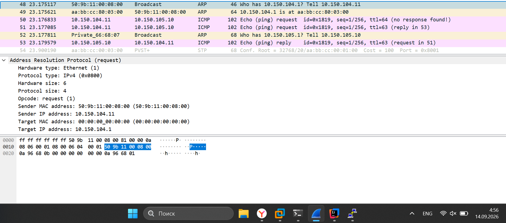
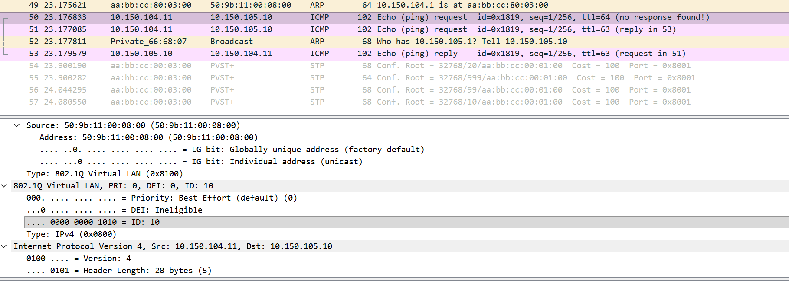
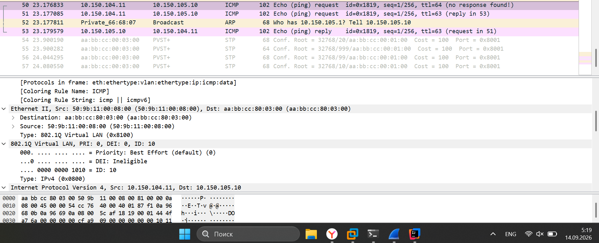
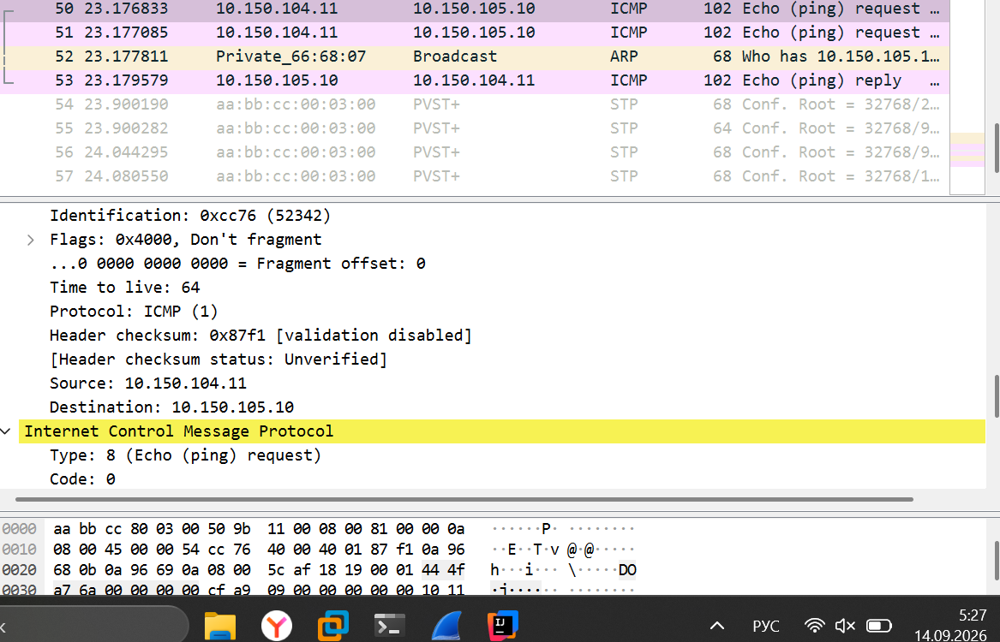
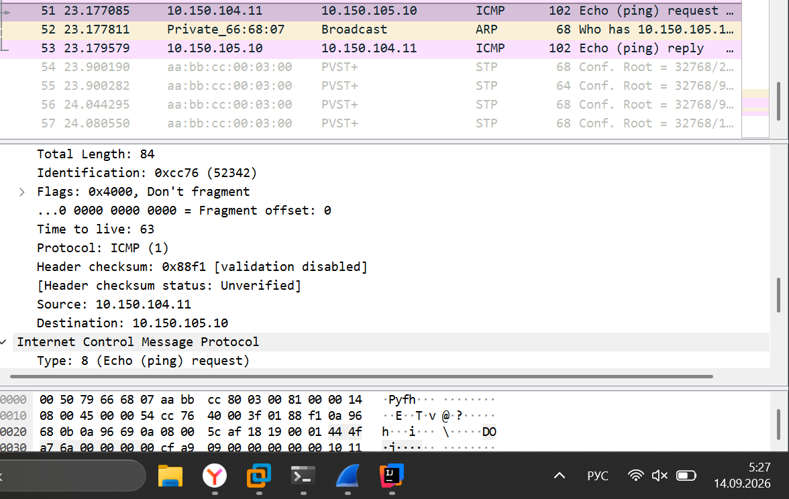
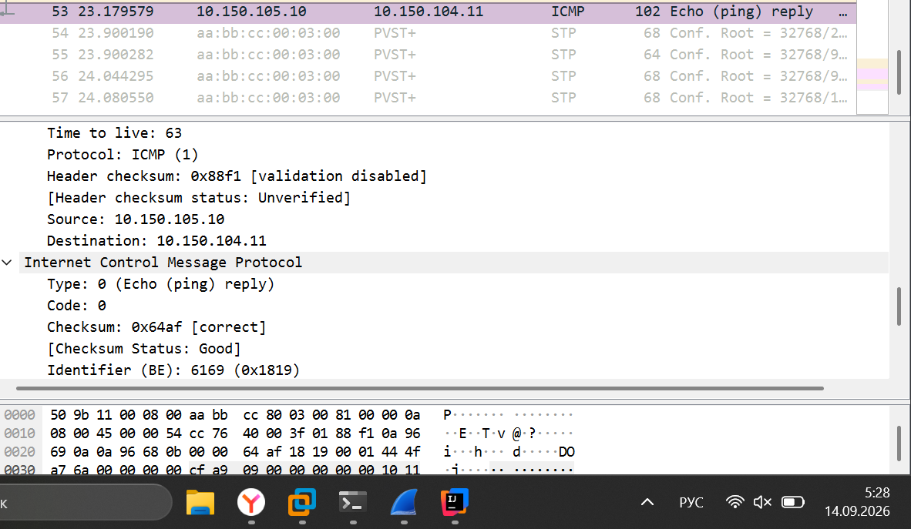
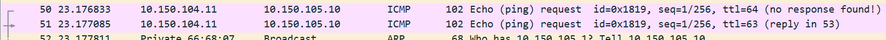
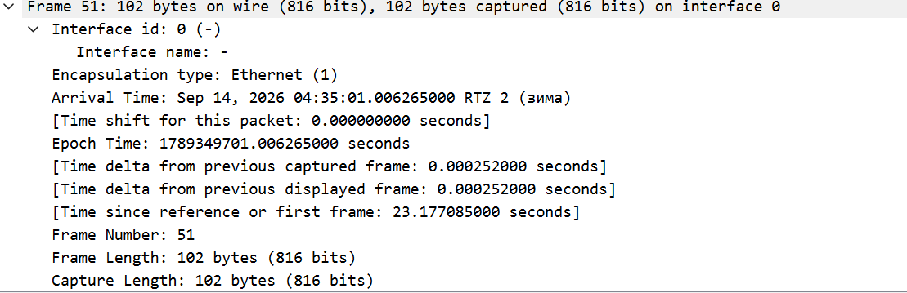
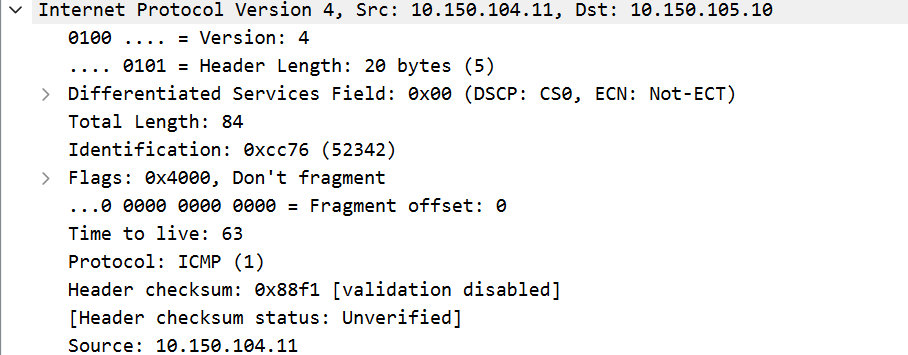

## Задание 4. Разбор трафика
1) Какие кадры прошли до первого ICMP-пакета? Кому был адресован ARP-запрос и почему именно ему, а не SRV1?
 **Ответ:** первые кадры пошел широковещательный запрос, для того чтобы найти шлюз по устройства(строчка 48).ARP запрос был адресован распределительному коммутатору, так как устройство не знает куда подавать трафик, ведь устройство находиться в другой подсети, мы вначале узнаем путь до шлюза, чтобы потом узнать где находиться srv1.  

2) Найдите в кадре 802.1Q-тег. Какой VLAN ID в нём указан? Почему тег вообще присутствует на этой линии, хотя на порту PC1 его не было?
 **Ответ:** На скриншоте ниже мы можем увидеть что фрейм имеет тег, где vlan id 10. Тег присутствует потому что мы указали это в trunk портах, благодаря trunk у нас фремы обычные превращаются с тегом, в которм есть как раз vlan.  

3) Выпишите MAC-адреса источника и назначения в ICMP-запросе на этой линии. Кому они принадлежат? Совпадает ли MAC назначения с MAC-адресом SRV1 — и если нет, то почему.
 **Ответ:** Тут source: 50:9b:11:00:08:00 Destination: aa:bb:cc:80:03:00, mac-адрес отправителя это pc-1, а mac-адресс получателя это коммутатор ядра. ARP запрос до этого был только до коммутатора ядра, поэтому первый пакет icmp пошел к нему  

4) Выпишите IP-адреса источника и назначения. Изменились ли они по сравнению с тем, что отправил PC1?
 **Ответ:** ip источника и назначения не поменялись. Единственное, когда запрос icmp пошел обратно(reply), у нас источник и назначение поменялись местами, но ip те же  

5) Найдите поле TTL. Какое значение вы видите? Какое значение будет у этого же пакета на линии между sw-core и sw-2-as? Почему при этом приходится пересчитывать контрольную сумму заголовка?
 **Ответ:** Так как у меня wireshark работает не только на провод, а еще и в целом на устройство, из скриншота ниже можно увидеть, что ttl уменьшился на 1 на участке sw-core по sw-2-as. Контрольную сумму приходиться пересчитывать, потому что у нас на каждом шаге кадр меняется, ttl уменьшается, может появиться tag, из-за этого приходться все время считать новый хеш.  

6) Разложите один захваченный ICMP-запрос по уровням модели OSI: какой заголовок какому уровню соответствует.
 **Ответ:** icmp это протокол сетевого уровня, так что выше мы не уйдем. Из скриншотов видны frame, который является вторым уровнем osi(канальный) и internet(3 уровень osi - сетевой)  

