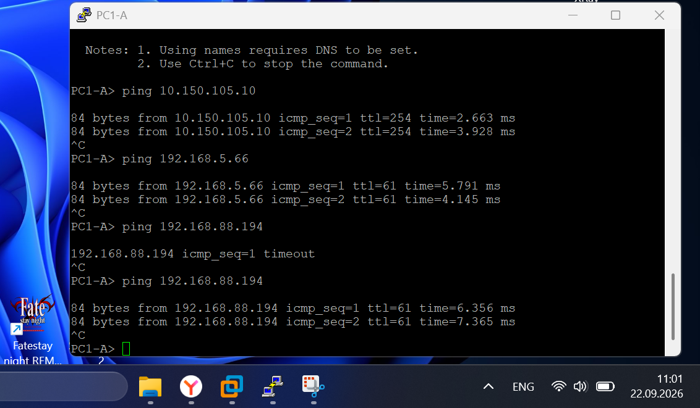
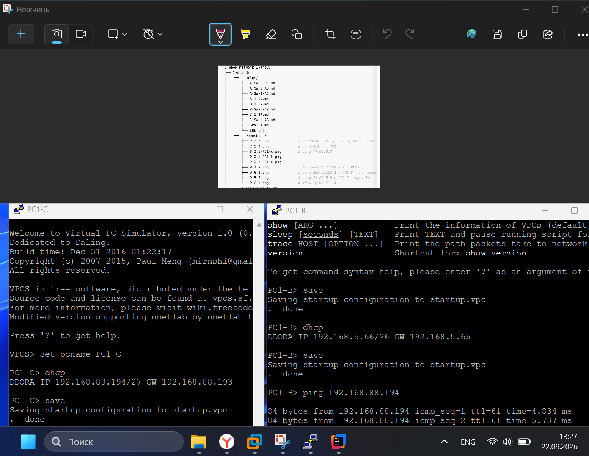
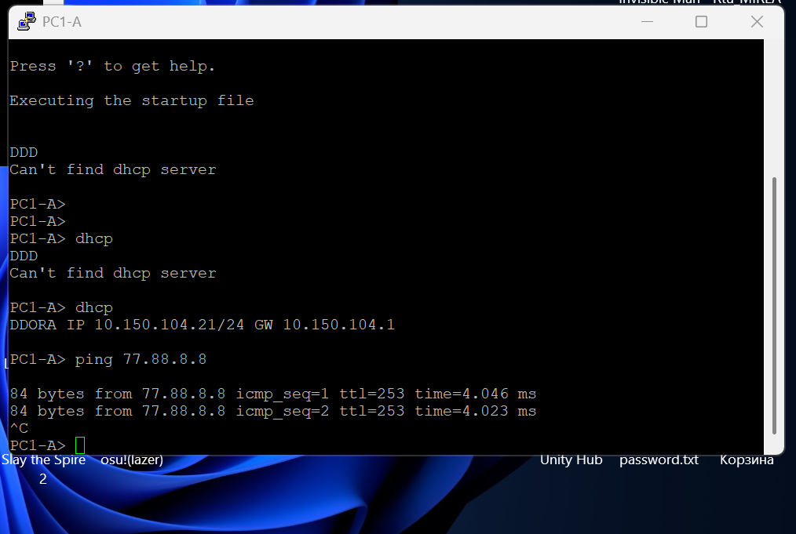
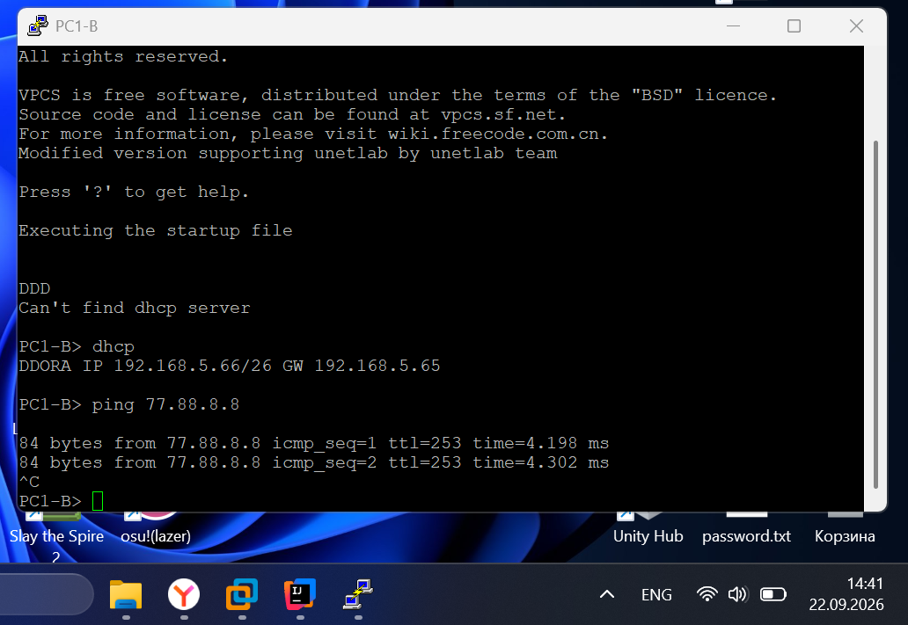
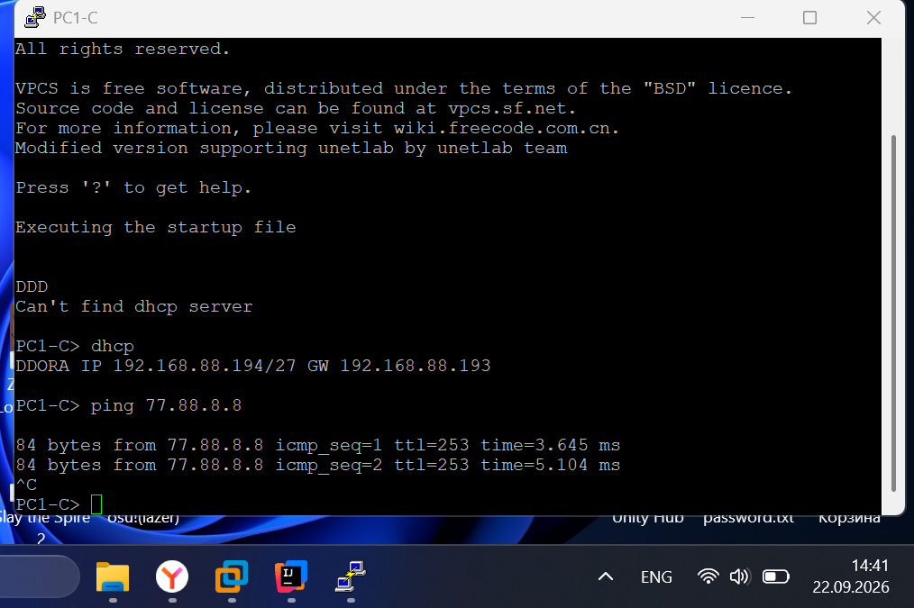
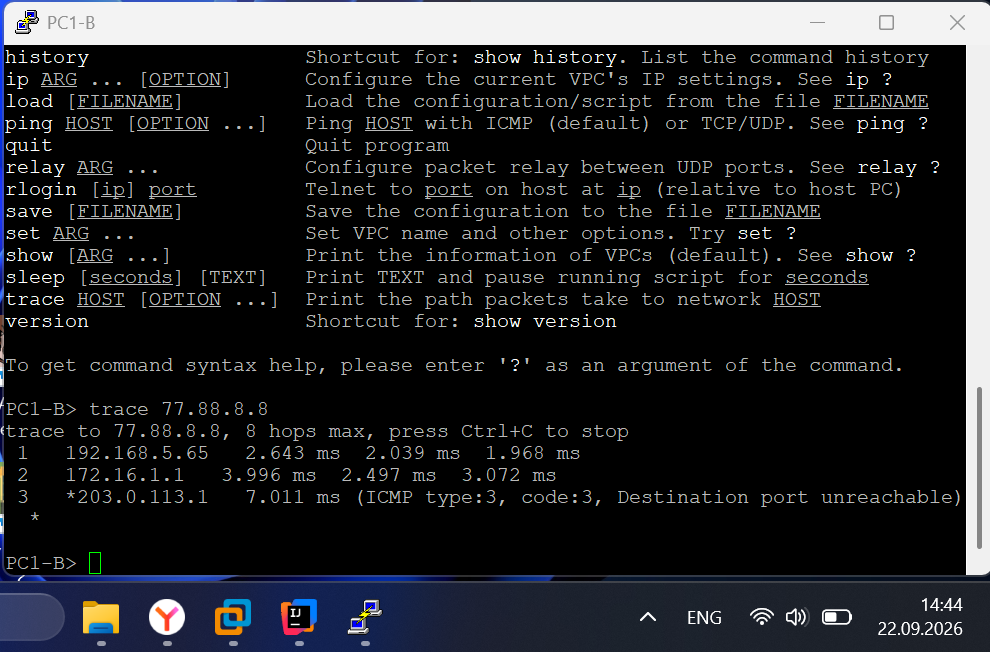
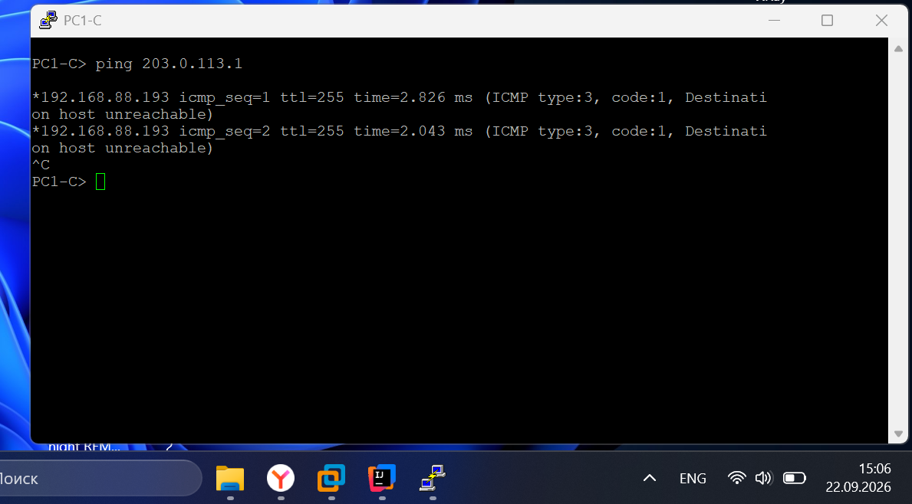
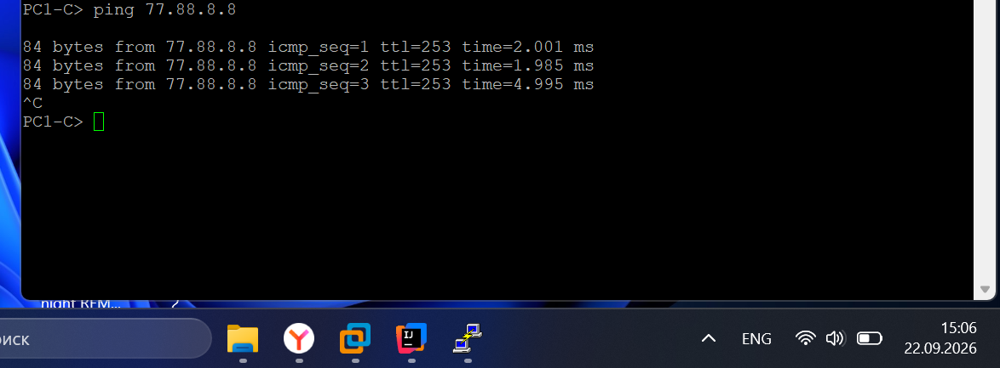
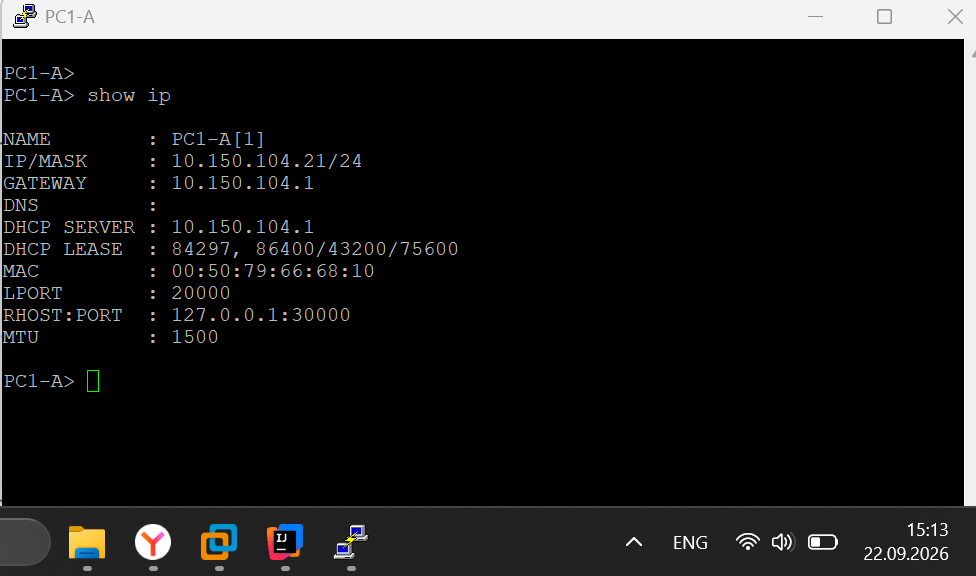

## 9.1 Аргегация и L2 в офисе A

### 9.1.1 show etherchannel summary(A-SW-CORE)
```
A-SW-CORE#show etherchannel summary
Flags:  D - down        P - bundled in port-channel
        I - stand-alone s - suspended
        H - Hot-standby (LACP only)
        R - Layer3      S - Layer2
        U - in use      N - not in use, no aggregation
        f - failed to allocate aggregator

        M - not in use, minimum links not met
        m - not in use, port not aggregated due to minimum links not met
        u - unsuitable for bundling
        w - waiting to be aggregated
        d - default port

        A - formed by Auto LAG


Number of channel-groups in use: 2
Number of aggregators:           2

Group  Port-channel  Protocol    Ports
------+-------------+-----------+-----------------------------------------------
1      Po1(SU)         LACP      Et0/0(P)    Et0/1(P)
2      Po2(SU)         LACP      Et0/2(P)    Et0/3(P)

A-SW-CORE#
```
### 9.1.2 show interfaces trunk(A-SW-CORE)
```
A-SW-CORE#show interfaces trunk

Port        Mode             Encapsulation  Status        Native vlan
Po1         on               802.1q         trunking      999
Po2         on               802.1q         trunking      999

Port        Vlans allowed on trunk
Po1         2-4094
Po2         2-4094

Port        Vlans allowed and active in management domain
Po1         10,20,99,999
Po2         10,20,99,999

Port        Vlans in spanning tree forwarding state and not pruned
Po1         10,20,99,999
Po2         10,20,99,999
A-SW-CORE#
```
### 9.1.3 show spanning-tree vlan 10(A-SW-CORE)
```
A-SW-CORE#show spanning-tree vlan 10

VLAN0010
  Spanning tree enabled protocol ieee
  Root ID    Priority    32778
             Address     aabb.cc00.0100
             Cost        56
             Port        66 (Port-channel2)
             Hello Time   2 sec  Max Age 20 sec  Forward Delay 15 sec

  Bridge ID  Priority    32778  (priority 32768 sys-id-ext 10)
             Address     aabb.cc00.0300
             Hello Time   2 sec  Max Age 20 sec  Forward Delay 15 sec
             Aging Time  300 sec

Interface           Role Sts Cost      Prio.Nbr Type
------------------- ---- --- --------- -------- --------------------------------
Po1                 Desg FWD 56        128.65   P2p
Po2                 Root FWD 56        128.66   P2p


A-SW-CORE#
```
## 9.2 Маршрутизация внутри сети
### 9.2.1 show ip interface brief и ping 10.150.111.254(A-SW-CORE)
```
A-SW-CORE#show ip interface brief
Interface              IP-Address      OK? Method Status                Protocol
Ethernet0/0            unassigned      YES unset  up                    up
Ethernet0/1            unassigned      YES unset  up                    up
Ethernet0/2            unassigned      YES unset  up                    up
Ethernet0/3            unassigned      YES unset  up                    up
Ethernet1/0            10.150.111.253  YES NVRAM  up                    up
Ethernet1/1            unassigned      YES unset  up                    up
Ethernet1/2            unassigned      YES unset  up                    up
Ethernet1/3            unassigned      YES unset  up                    up
Port-channel1          unassigned      YES unset  up                    up
Port-channel2          unassigned      YES unset  up                    up
Vlan10                 10.150.104.1    YES NVRAM  up                    up
Vlan20                 10.150.105.1    YES NVRAM  up                    up
Vlan99                 10.150.110.1    YES NVRAM  up                    up
A-SW-CORE#ping 10.150.111.254
Type escape sequence to abort.
Sending 5, 100-byte ICMP Echos to 10.150.111.254, timeout is 2 seconds:
!!!!!
Success rate is 100 percent (5/5), round-trip min/avg/max = 1/1/2 ms
A-SW-CORE#
```
### 9.2.2 ping SRV1-A, ping PC1-B, ping PC1-C(PC1-A)

### 9.2.3 ping PC1-C(PC1-B)

### 9.2.4 ping 192.168.5.98(A-1-BR)
```
A-1-BR#ping 192.168.5.98
Type escape sequence to abort.
Sending 5, 100-byte ICMP Echos to 192.168.5.98, timeout is 2 seconds:
!!!!!
Success rate is 100 percent (5/5), round-trip min/avg/max = 1/1/1 ms
A-1-BR#
```
## 9.3 Выход в интернет
### 9.3.1 ping 77.88.8.8(PC1-A, PC1-B, PC1-C)



### 9.3.2 traceroute 77.88.8.8(PC1-B)

### 9.3.3 show ip route(Inet)
```
Inet#show ip route
Codes: L - local, C - connected, S - static, R - RIP, M - mobile, B - BGP
       D - EIGRP, EX - EIGRP external, O - OSPF, IA - OSPF inter area
       N1 - OSPF NSSA external type 1, N2 - OSPF NSSA external type 2
       E1 - OSPF external type 1, E2 - OSPF external type 2
       i - IS-IS, su - IS-IS summary, L1 - IS-IS level-1, L2 - IS-IS level-2
       ia - IS-IS inter area, * - candidate default, U - per-user static route
       o - ODR, P - periodic downloaded static route, H - NHRP, l - LISP
       a - application route
       + - replicated route, % - next hop override

Gateway of last resort is not set

      77.0.0.0/32 is subnetted, 1 subnets
C        77.88.8.8 is directly connected, Loopback0
      203.0.113.0/24 is variably subnetted, 2 subnets, 2 masks
C        203.0.113.0/24 is directly connected, Ethernet0/0
L        203.0.113.1/32 is directly connected, Ethernet0/0
Inet#
```

## 9.4 Публикация сервера
### 9.4.1 ping 203.0.113.20, затем telnet 203.0.113.20 80(INET)
ping:
```
Inet#ping 203.0.113.20
Type escape sequence to abort.
Sending 5, 100-byte ICMP Echos to 203.0.113.20, timeout is 2 seconds:
...!!
Success rate is 40 percent (2/5), round-trip min/avg/max = 1/2/4 ms
Inet#ping 203.0.113.20
Type escape sequence to abort.
Sending 5, 100-byte ICMP Echos to 203.0.113.20, timeout is 2 seconds:
!!!!!
Success rate is 100 percent (5/5), round-trip min/avg/max = 2/3/5 ms
Inet#
```
telnet:
```
Inet#telnet 203.0.113.20 80
Trying 203.0.113.20, 80 ... Open
```
### 9.4.2 show ip nat translations(A-1-BR)
```
A-1-BR#show ip nat translations
Pro Inside global      Inside local       Outside local      Outside global
icmp 203.0.113.20:2    10.150.105.10:2    203.0.113.1:2      203.0.113.1:2
tcp 203.0.113.20:80    10.150.105.10:80   203.0.113.1:30697  203.0.113.1:30697
--- 203.0.113.20       10.150.105.10      ---                ---
A-1-BR#
```
## 9.5 Проверки «от обратного»
### 9.5.1 ping 10.150.105.10(INET) - не проходит
```
Inet#ping 10.150.105.10
Type escape sequence to abort.
Sending 5, 100-byte ICMP Echos to 10.150.105.10, timeout is 2 seconds:
.....
Success rate is 0 percent (0/5)
Inet#
```
### 9.5.2 ping 203.0.113.1(PC1-C) - не проходит

### 9.5.3 ping 77.88.8.8(PC1-C) - проходит


**Объяснение 9.5.2 и 9.5.3:** <br> 
Эти строчки разные потому что мы не указали маршрут по умолчанию на C-1-BR. 
Поэтому, когда пакет ICMP идет к сети, он останавливается и уходит обратно, так как там нет маршрута 203.0.113.1.
Чтобы это решить нужно просто добавить строчку ip route 0.0.0.0 0.0.0.0 172.17.5.25 в C-1-BR.
## 9.6 DHCP
### 9.6.1 show ip(PC1-A)

### 9.6.2 show ip dhcp binding(A-SW-CORE)
```
A-SW-CORE#show ip dhcp binding
Bindings from all pools not associated with VRF:
IP address      Client-ID/              Lease expiration        Type       State      Interface
                Hardware address/
                User name
10.150.104.21    0100.5079.6668.10       Sep 23 2026 11:38 AM    Automatic  Active     Vlan10
A-SW-CORE#
```
### 9.6.3 ping SRV1-A(PC1-A)
```
PC1-A> ping 10.150.105.10

84 bytes from 10.150.105.10 icmp_seq=1 ttl=254 time=4.953 ms
84 bytes from 10.150.105.10 icmp_seq=2 ttl=254 time=5.185 ms
84 bytes from 10.150.105.10 icmp_seq=3 ttl=254 time=3.976 ms
^C
PC1-A>
```
