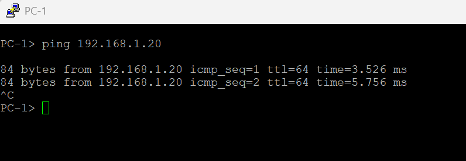
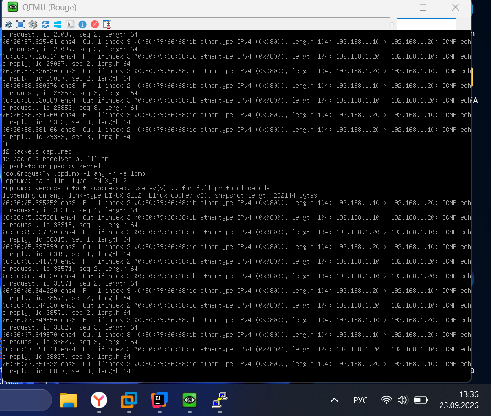
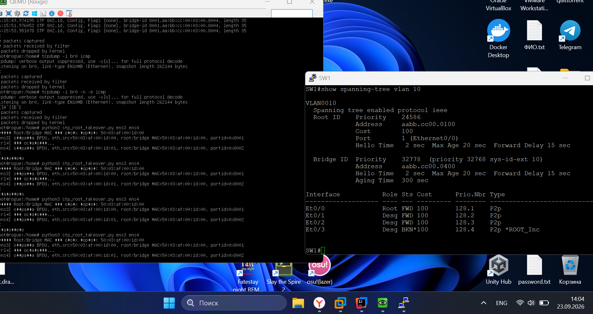
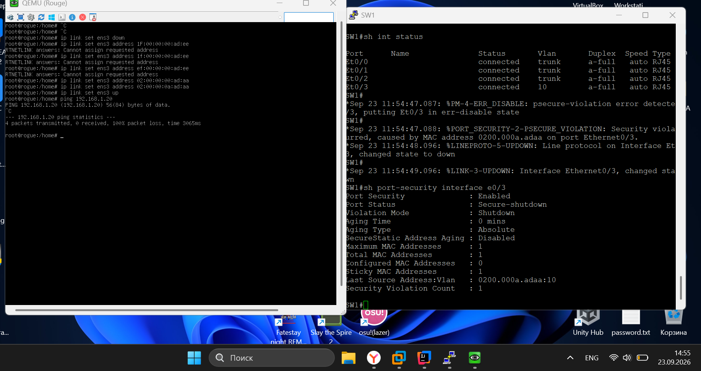
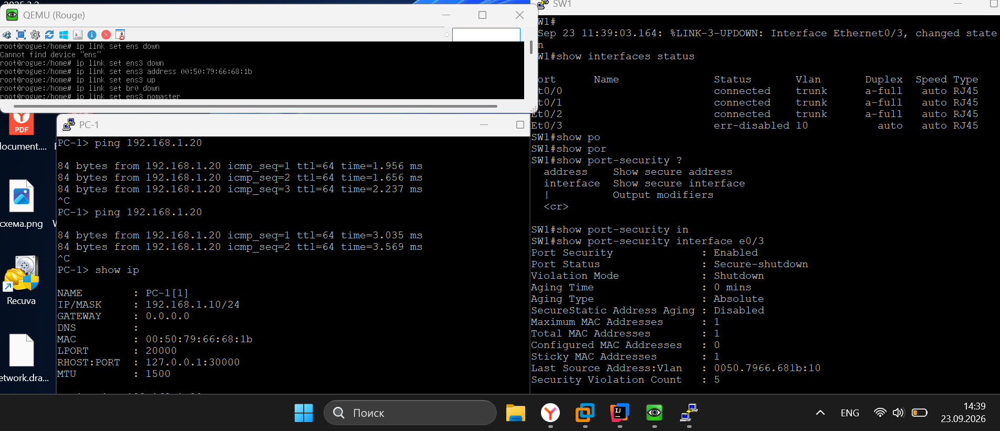

## Раздел 2.1: Просто PVST+
### 2.1.1 show interfaces trunk(SW1–SW4)
SW1:
```
SW1#show interfaces trunk

Port        Mode             Encapsulation  Status        Native vlan
Et0/0       on               802.1q         trunking      1
Et0/1       on               802.1q         trunking      1
Et0/2       on               802.1q         trunking      1

Port        Vlans allowed on trunk
Et0/0       10,20,30,99
Et0/1       10,20,30,99
Et0/2       10,20,30,99

Port        Vlans allowed and active in management domain
Et0/0       10,20,30,99
Et0/1       10,20,30,99
Et0/2       10,20,30,99

Port        Vlans in spanning tree forwarding state and not pruned
Et0/0       10,20,30,99
Et0/1       10,20
Et0/2       10,20
```
SW2:
```
SW2#show interfaces trunk

Port        Mode             Encapsulation  Status        Native vlan
Et0/0       on               802.1q         trunking      1
Et0/1       on               802.1q         trunking      1
Et0/2       on               802.1q         trunking      1

Port        Vlans allowed on trunk
Et0/0       10,20,30,99
Et0/1       10,20,30,99
Et0/2       10,20,30,99

Port        Vlans allowed and active in management domain
Et0/0       10,20,30,99
Et0/1       10,20,30,99
Et0/2       10,20,30,99

Port        Vlans in spanning tree forwarding state and not pruned
Et0/0       10,20,30,99
Et0/1       30,99
Et0/2       30,99
```
SW3:
```
SW3#show interfaces trunk

Port        Mode             Encapsulation  Status        Native vlan
Et0/0       on               802.1q         trunking      1
Et0/1       on               802.1q         trunking      1

Port        Vlans allowed on trunk
Et0/0       10,20,30,99
Et0/1       10,20,30,99

Port        Vlans allowed and active in management domain
Et0/0       10,20,30,99
Et0/1       10,20,30,99

Port        Vlans in spanning tree forwarding state and not pruned
Et0/0       10,20,30,99
Et0/1       10,20,30,99
```
SW4:
```
SW4#show interfaces trunk

Port        Mode             Encapsulation  Status        Native vlan
Et0/0       on               802.1q         trunking      1
Et0/1       on               802.1q         trunking      1

Port        Vlans allowed on trunk
Et0/0       10,20,30,99
Et0/1       10,20,30,99

Port        Vlans allowed and active in management domain
Et0/0       10,20,30,99
Et0/1       10,20,30,99

Port        Vlans in spanning tree forwarding state and not pruned
Et0/0       10,20,30,99
Et0/1       10,20,30,99
```
### 2.1.2 show spanning tree vlan 10, show spanning-tree vlan 30(SW1-SW-4)
SW1:
```
SW1#show spanning-tree vlan 10

VLAN0010
  Spanning tree enabled protocol ieee
  Root ID    Priority    24586
             Address     aabb.cc00.0100
             Cost        100
             Port        1 (Ethernet0/0)
             Hello Time   2 sec  Max Age 20 sec  Forward Delay 15 sec

  Bridge ID  Priority    32778  (priority 32768 sys-id-ext 10)
             Address     aabb.cc00.0400
             Hello Time   2 sec  Max Age 20 sec  Forward Delay 15 sec
             Aging Time  300 sec

Interface           Role Sts Cost      Prio.Nbr Type
------------------- ---- --- --------- -------- --------------------------------
Et0/0               Root FWD 100       128.1    P2p
Et0/1               Desg FWD 100       128.2    P2p
Et0/2               Desg FWD 100       128.3    P2p


SW1#show spanning-tree vlan 30

VLAN0030
  Spanning tree enabled protocol ieee
  Root ID    Priority    24606
             Address     aabb.cc00.0200
             Cost        200
             Port        1 (Ethernet0/0)
             Hello Time   2 sec  Max Age 20 sec  Forward Delay 15 sec

  Bridge ID  Priority    32798  (priority 32768 sys-id-ext 30)
             Address     aabb.cc00.0400
             Hello Time   2 sec  Max Age 20 sec  Forward Delay 15 sec
             Aging Time  300 sec

Interface           Role Sts Cost      Prio.Nbr Type
------------------- ---- --- --------- -------- --------------------------------
Et0/0               Root FWD 100       128.1    P2p
Et0/1               Altn BLK 100       128.2    P2p
Et0/2               Altn BLK 100       128.3    P2p

```
SW2:
```
SW2#show spanning-tree vlan 10

VLAN0010
  Spanning tree enabled protocol ieee
  Root ID    Priority    24586
             Address     aabb.cc00.0100
             Cost        200
             Port        1 (Ethernet0/0)
             Hello Time   2 sec  Max Age 20 sec  Forward Delay 15 sec

  Bridge ID  Priority    32778  (priority 32768 sys-id-ext 10)
             Address     aabb.cc00.0300
             Hello Time   2 sec  Max Age 20 sec  Forward Delay 15 sec
             Aging Time  300 sec

Interface           Role Sts Cost      Prio.Nbr Type
------------------- ---- --- --------- -------- --------------------------------
Et0/0               Root FWD 100       128.1    P2p
Et0/1               Altn BLK 100       128.2    P2p
Et0/2               Altn BLK 100       128.3    P2p


SW2#show spanning-tree vlan 30

VLAN0030
  Spanning tree enabled protocol ieee
  Root ID    Priority    24606
             Address     aabb.cc00.0200
             Cost        100
             Port        1 (Ethernet0/0)
             Hello Time   2 sec  Max Age 20 sec  Forward Delay 15 sec

  Bridge ID  Priority    32798  (priority 32768 sys-id-ext 30)
             Address     aabb.cc00.0300
             Hello Time   2 sec  Max Age 20 sec  Forward Delay 15 sec
             Aging Time  300 sec

Interface           Role Sts Cost      Prio.Nbr Type
------------------- ---- --- --------- -------- --------------------------------
Et0/0               Root FWD 100       128.1    P2p
Et0/1               Desg FWD 100       128.2    P2p
Et0/2               Desg FWD 100       128.3    P2p


```
SW3:
```
SW3#show spanning-tree vlan 10

VLAN0010
  Spanning tree enabled protocol ieee
  Root ID    Priority    24586
             Address     aabb.cc00.0100
             This bridge is the root
             Hello Time   2 sec  Max Age 20 sec  Forward Delay 15 sec

  Bridge ID  Priority    24586  (priority 24576 sys-id-ext 10)
             Address     aabb.cc00.0100
             Hello Time   2 sec  Max Age 20 sec  Forward Delay 15 sec
             Aging Time  300 sec

Interface           Role Sts Cost      Prio.Nbr Type
------------------- ---- --- --------- -------- --------------------------------
Et0/0               Desg FWD 100       128.1    P2p
Et0/1               Desg FWD 100       128.2    P2p
Et0/2               Desg FWD 100       128.3    P2p


SW3#show spanning-tree vlan 30

VLAN0030
  Spanning tree enabled protocol ieee
  Root ID    Priority    24606
             Address     aabb.cc00.0200
             Cost        100
             Port        2 (Ethernet0/1)
             Hello Time   2 sec  Max Age 20 sec  Forward Delay 15 sec

  Bridge ID  Priority    32798  (priority 32768 sys-id-ext 30)
             Address     aabb.cc00.0100
             Hello Time   2 sec  Max Age 20 sec  Forward Delay 15 sec
             Aging Time  300 sec

Interface           Role Sts Cost      Prio.Nbr Type
------------------- ---- --- --------- -------- --------------------------------
Et0/0               Desg FWD 100       128.1    P2p
Et0/1               Root FWD 100       128.2    P2p


```
SW4:
```
SW4#show spanning-tree vlan 10

VLAN0010
  Spanning tree enabled protocol ieee
  Root ID    Priority    24586
             Address     aabb.cc00.0100
             Cost        100
             Port        2 (Ethernet0/1)
             Hello Time   2 sec  Max Age 20 sec  Forward Delay 15 sec

  Bridge ID  Priority    32778  (priority 32768 sys-id-ext 10)
             Address     aabb.cc00.0200
             Hello Time   2 sec  Max Age 20 sec  Forward Delay 15 sec
             Aging Time  300 sec

Interface           Role Sts Cost      Prio.Nbr Type
------------------- ---- --- --------- -------- --------------------------------
Et0/0               Desg FWD 100       128.1    P2p
Et0/1               Root FWD 100       128.2    P2p
Et0/2               Desg FWD 100       128.3    P2p


SW4#show spanning-tree vlan 30

VLAN0030
  Spanning tree enabled protocol ieee
  Root ID    Priority    24606
             Address     aabb.cc00.0200
             This bridge is the root
             Hello Time   2 sec  Max Age 20 sec  Forward Delay 15 sec

  Bridge ID  Priority    24606  (priority 24576 sys-id-ext 30)
             Address     aabb.cc00.0200
             Hello Time   2 sec  Max Age 20 sec  Forward Delay 15 sec
             Aging Time  300 sec

Interface           Role Sts Cost      Prio.Nbr Type
------------------- ---- --- --------- -------- --------------------------------
Et0/0               Desg FWD 100       128.1    P2p
Et0/1               Desg FWD 100       128.2    P2p


```
### 2.1.3 ping до PC-2(PC-1)


## Раздел 2.2: Неприятный гость
### 2.2.1 show spanning-tree vlan 10(SW1,SW2)
SW1:
```
SW1#show spanning-tree vlan 10

VLAN0010
Spanning tree enabled protocol ieee
Root ID    Priority    0
Address     5003.af00.1d00
Cost        100
Port        4 (Ethernet0/3)
Hello Time   2 sec  Max Age 20 sec  Forward Delay 15 sec

Bridge ID  Priority    32778  (priority 32768 sys-id-ext 10)
Address     aabb.cc00.0400
Hello Time   2 sec  Max Age 20 sec  Forward Delay 15 sec
Aging Time  300 sec

Interface           Role Sts Cost      Prio.Nbr Type
------------------- ---- --- --------- -------- --------------------------------
Et0/0               Desg FWD 100       128.1    P2p
Et0/1               Altn BLK 100       128.2    P2p
Et0/2               Altn BLK 100       128.3    P2p
Et0/3               Root FWD 100       128.4    P2p

```
SW2:
```
SW2#show spanning-tree vlan 10

VLAN0010
  Spanning tree enabled protocol ieee
  Root ID    Priority    0
             Address     5003.af00.1d00
             Cost        100
             Port        4 (Ethernet0/3)
             Hello Time   2 sec  Max Age 20 sec  Forward Delay 15 sec

  Bridge ID  Priority    32778  (priority 32768 sys-id-ext 10)
             Address     aabb.cc00.0300
             Hello Time   2 sec  Max Age 20 sec  Forward Delay 15 sec
             Aging Time  300 sec

Interface           Role Sts Cost      Prio.Nbr Type
------------------- ---- --- --------- -------- --------------------------------
Et0/0               Desg FWD 100       128.1    P2p
Et0/1               Desg FWD 100       128.2    P2p
Et0/2               Desg FWD 100       128.3    P2p
Et0/3               Root FWD 100       128.4    P2p

```
### 2.2.2 дамп на br0 с фильтром icmp
Тут дампинг только с ens3(eth0):
[catch_you.pcapng](catch_you.pcapng),
так как capture не получается взять у виртуального интерфейса, поэтому я скину tcpdump скриншот как дополнение:


## Раздел 2.3: Защита STP
### 2.3.1 повторить атаку (скрипт на ROGUE)

### 2.3.2 show interfaces status err-disabled(SW1, SW2)
Вывод пустой, так как мы настроили root guard, теперь bpdu просто не проходит, поэтому нету и ошибки.
### 2.3.3 show spanning-tree vlan 10(SW1, SW2)
SW1:
```
SW1#show spanning-tree vlan 10

VLAN0010
  Spanning tree enabled protocol ieee
  Root ID    Priority    24586
             Address     aabb.cc00.0100
             Cost        100
             Port        1 (Ethernet0/0)
             Hello Time   2 sec  Max Age 20 sec  Forward Delay 15 sec

  Bridge ID  Priority    32778  (priority 32768 sys-id-ext 10)
             Address     aabb.cc00.0400
             Hello Time   2 sec  Max Age 20 sec  Forward Delay 15 sec
             Aging Time  300 sec

Interface           Role Sts Cost      Prio.Nbr Type
------------------- ---- --- --------- -------- --------------------------------
Et0/0               Root FWD 100       128.1    P2p
Et0/1               Desg FWD 100       128.2    P2p
Et0/2               Desg FWD 100       128.3    P2p
Et0/3               Desg BKN*100       128.4    P2p *ROOT_Inc


SW1#
```
SW2:
```
SW2#show spanning-tree vlan 10

VLAN0010
  Spanning tree enabled protocol ieee
  Root ID    Priority    24586
             Address     aabb.cc00.0100
             Cost        200
             Port        1 (Ethernet0/0)
             Hello Time   2 sec  Max Age 20 sec  Forward Delay 15 sec

  Bridge ID  Priority    32778  (priority 32768 sys-id-ext 10)
             Address     aabb.cc00.0300
             Hello Time   2 sec  Max Age 20 sec  Forward Delay 15 sec
             Aging Time  300 sec

Interface           Role Sts Cost      Prio.Nbr Type
------------------- ---- --- --------- -------- --------------------------------
Et0/0               Root FWD 100       128.1    P2p
Et0/1               Altn BLK 100       128.2    P2p
Et0/2               Altn BLK 100       128.3    P2p
Et0/3               Desg BKN*100       128.4    P2p *ROOT_Inc


SW2#
```
## Раздел 2.4: Port Security
### 2.4.1 show port-security address(SW3)
```
SW3#show port-security address
               Secure Mac Address Table
-----------------------------------------------------------------------------
Vlan    Mac Address       Type                          Ports   Remaining Age
                                                                   (mins)
----    -----------       ----                          -----   -------------
  10    0050.7966.681b    SecureSticky                  Et0/2        -
-----------------------------------------------------------------------------
Total Addresses in System (excluding one mac per port)     : 0
Max Addresses limit in System (excluding one mac per port) : 4096
SW3#
```
### 2.4.2 подключить ROGUE с другим MAC, затем ping и show port-security interface Gi0/x

### 2.4.3 подменить на ROGUE MAC на адрес легитимного PC, повторить ping

